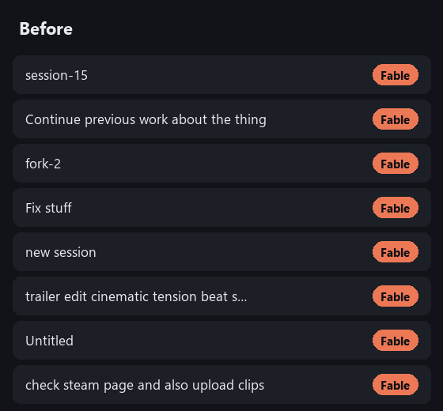
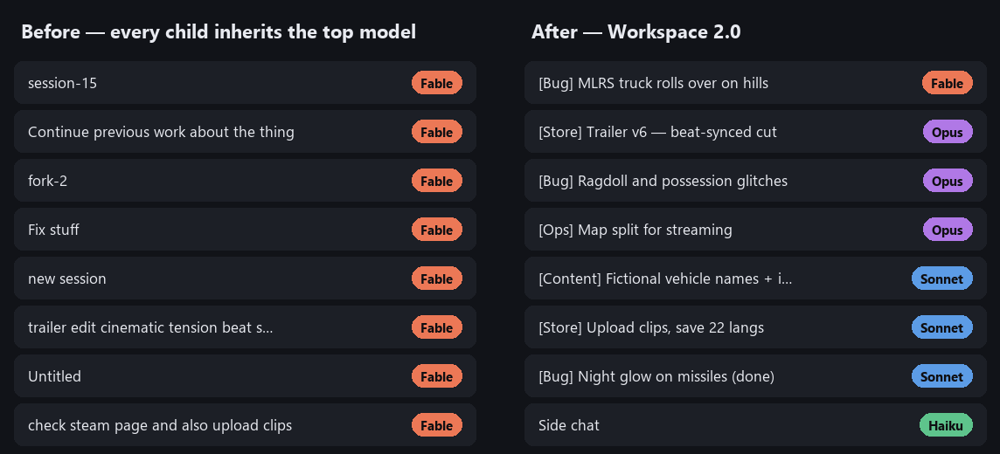
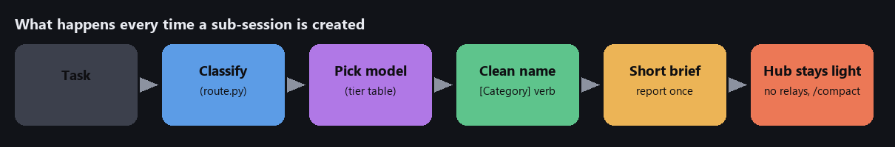
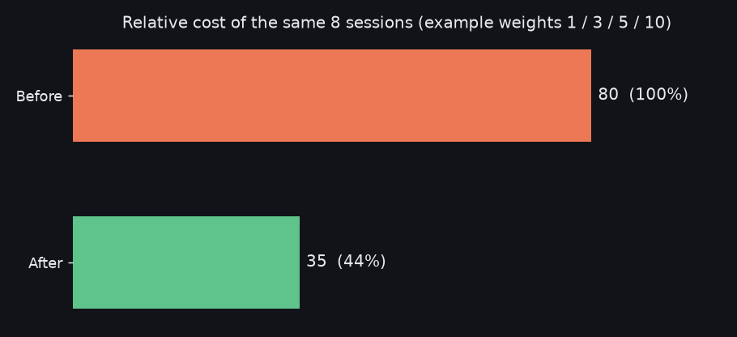

# Workspace 2.0

[](https://discord.gg/PTPV93Zd59) [](https://ko-fi.com/zip_yogurt)

**Claude Code에서 서브 세션 · 서브 에이전트를 싸게 굴리고, Claude가 짧고 정확하게 말하게 하는 도구 모음.**
서브 세션을 만들 때마다 그 일에 맞는 모델로 바꾸고, 이름을 깔끔하게 짓고, 짧은 브리프를 쓰고, 총괄 세션이 쓸데없이 토큰을 먹지 않게 한다. 슬래시 명령 한 줄로 모두 부를 수 있다.



## 왜 필요한가

개발할 때 속도 때문에 서브 세션을 여럿 띄운다. 그런데 **새 세션은 부모와 같은 모델로 시작한다.** 총괄이 가장 비싼 모델이면 파일 올리기 · 이름 바꾸기 · 시험 돌리기만 하는 세션도 전부 가장 비싼 모델로 돈다. 이름은 `session-15`, `fork-2`처럼 남아 사이드바가 무엇을 하는지 알 수 없게 된다.



## 하는 일



| 기능 | 내용 |
| --- | --- |
| **모델 자동 고르기** | 일의 종류로 네 단계(light · standard · deep · frontier) 중 하나를 골라 세션을 만든 직후 모델을 바꾼다. 가장 비싼 모델은 한 번에 하나만 |
| **쉬는 세션은 한 단계 아래로** | 끝나고 대기 중인 세션은 싼 모델로 내려 다시 깨울 때 덜 든다 |
| **실패하면 올린다** | 낮은 단계에서 시작하고, 같은 실패가 두 번 나오면 한 단계 올린다 |
| **깔끔한 이름** | `[분류] 동사 + 대상 — 범위`, 45자 안. `session-15` → `[Bug] Night glow on missiles` |
| **짧은 브리프** | 목표 · 이미 아는 것 · 볼 파일 · 끝 조건 · 보고는 한 번. "CLAUDE.md 다 읽어" 같은 낭비 금지 |
| **턴을 끝내고 기다리지 않기** | "알림 오면 할게요" 하고 턴을 끝낸 세션은 아무도 안 깨운다. 끝날 때까지 이어서 하게 브리프에 적는다 |
| **총괄을 가볍게** | 자식 보고를 매번 옮기지 않음 · 끝난 세션 다시 깨우지 않음 · 20만 토큰 넘으면 `/compact` · 5시간 한도를 보고 동시 세션 수 조절 |
| **전체 점검** | "세션마다 맞는 모델로" 한 마디면 연결된 세션 전부를 훑어 표로 보여 주고 바꾼다 |
| **짧고 정확하게 말하기** (새) | 인사말 · 되풀이 · 군말을 빼고 결론부터. 숫자 · 경로 · "안 됨/~일 때만"은 절대 안 줄인다. 끝 보고는 늘 `결과 / 바꾼 것 / 안 한 것 / 다음` 순서 |
| **슬래시 명령** (새) | `/ws-spawn`, `/ws-audit`, `/ws-terse` 등 11개. 단순한 명령은 싼 모델로 돈다 |
| **긴 코드 나누기** (새) | 새 기능은 처음부터 따로 두고, 3,000줄 넘는 파일은 고치는 김에 그 주제를 새 파일로 옮긴다. 큰 파일을 통째로 읽는 토큰이 줄어든다 |

## 얼마나 줄어드나



위 그래프는 **예시 가중치(1 / 3 / 5 / 10)** 로 셈한 것이다. 실제 값은 요금제와 모델 가격에 따라 다르다. 가중치는 [`tools/make_visuals.py`](tools/make_visuals.py)의 `WEIGHTS`에서 바꿀 수 있다. 같은 세션 8개를 모두 가장 비싼 모델로 돌릴 때와 일에 맞게 나눌 때를 비교했다.

## 설치

```bash
git clone https://github.com/O3O-2022/Workspace-2.0.git
sh Workspace-2.0/install.sh
```

윈도 PowerShell:

```powershell
git clone https://github.com/O3O-2022/Workspace-2.0.git
powershell -ExecutionPolicy Bypass -File Workspace-2.0\install.ps1
```

스킬 · 슬래시 명령 · 출력 스타일을 `~/.claude`에 복사한다. 다시 설치해도 고쳐 둔 `models.json`은 그대로 남는다.
그다음 [`models.json`](skill/workspace-2/scripts/models.json)에 앱 모델 메뉴에 나오는 모델 이름을 단계마다 적는다.

## 쓰는 법

스킬은 서브 세션을 만들거나, 토큰 · 한도 이야기가 나오면 저절로 읽힌다. 직접 부를 수도 있다.

```text
세션마다 맞는 모델로 바꿔 줘
이 일을 서브 세션으로 넘겨 줘: 스팀 페이지에 영상 둘 올리고 22개 언어 저장
```

모델 고르기 도구만 따로 써도 된다(의존성 없음, 한국어 · 영어).

```bash
python skill/workspace-2/scripts/route.py --table \
  "fix the MLRS truck rolling over on hills" \
  "탈것 이름 바꾸고 번역 22개 언어" \
  "트레일러 어디까지함"
```

```text
| Session name                               | Tier     | Model             | Why            |
| [Bug] Fix the MLRS truck rolling over on…  | deep     | claude-opus-5-5   | fix            |
| [Content] 탈것 이름 바꾸고 번역 22개 언어      | standard | claude-sonnet-5-5 | 이름 바꾸, 번역 |
| [Store] 트레일러 어디까지함                   | light    | claude-haiku-5-5  | 어디까지        |
```

## 슬래시 명령

| 명령 | 하는 일 |
| --- | --- |
| `/ws` | 명령 목록 |
| `/ws-spawn <일>` | 서브 세션 시작: 맞는 모델 · 깔끔한 이름 · 짧은 브리프를 한 번에 |
| `/ws-route <일; 일>` | 단계 · 모델 · 이름만 표로 (세션은 안 만듦) |
| `/ws-brief <일>` | 브리프만 쓰기 |
| `/ws-audit` | 연결된 세션 전부를 맞는 모델로 |
| `/ws-name` | 이름이 흐린 세션(`session-15` 등)을 `[분류] 동사 + 대상`으로 |
| `/ws-idle` | 끝나고 기다리는 세션을 한 단계 아래 모델로 |
| `/ws-lighten` | 총괄 점검: 컨텍스트 크기 · 5시간 한도 · 보관할 세션 |
| `/ws-handoff` | 새 세션에 넘길 짧은 인계 메모 |
| `/ws-split <파일>` | 긴 코드 파일을 주제별로 나누기 (계획 먼저, 나눈 뒤 빌드 · 시험) |
| `/ws-terse [on\|off]` | 이 세션만 짧고 정확하게 말하기 |

`/ws`, `/ws-route`, `/ws-terse`는 Haiku, `/ws-brief`, `/ws-handoff`는 Sonnet으로 돈다(명령 파일의 `model:` 줄에서 바꿀 수 있다).

## 짧고 정확하게 말하기

모든 세션에 늘 켜 두려면 출력 스타일 **Workspace Terse**를 고른다(`/output-style` 또는 앱 설정). 한 세션만이면 `/ws-terse`.

| 뺀다 | 절대 안 뺀다 |
| --- | --- |
| 인사말 · 맺음말, 요청 되풀이, "이제 ~하겠습니다" 같은 예고, 도구 결과 되풀이, 안 쓸 선택지, 얼버무림 | 숫자 · 경로 · 이름 · 명령 · 오류 문구, 바뀐 것 · 안 바뀐 것 · 확인 안 된 것, 위험, "안 됨 / ~일 때만 / ~ 빼고" |

요약은 하되 암호처럼 줄이지 않는다. 뜻이 둘로 읽히면 고쳐 쓴다. 지우는 명령 · 보안 · 순서가 중요한 절차처럼 짧으면 잘못될 일만 길게 쓴다.

작업이 끝나면 늘 같은 순서로 보고한다:

```text
결과: 지금 무엇이 됐는지 한 줄
바꾼 것: 파일 · 설정 이름
안 한 것 / 확인 안 된 것: 없으면 "없음"
다음: 사용자가 정할 것 하나, 없으면 생략
```

## 긴 코드 나누기

Claude는 파일을 고칠 때 보통 통째로 읽는다. 큰 파일은 한 줄을 고쳐도 매번 그만큼 토큰을 쓰고, 고칠 곳도 찾기 어렵다. 출력 스타일 **Workspace Terse**에 들어 있어 켜 두면 늘 지킨다.

- **새 기능은 처음부터 따로.** 같은 클래스면 주제별 파일로 나눈다(C++: 헤더는 하나, 함수는 `Class_Topic.cpp` / C#: `partial class` / 그 밖: 모듈). 따로 서는 일이면 서브시스템이나 컴포넌트로 만든다.
- **3,000줄 기준.** 고치려는 파일이 3,000줄을 넘으면 고치는 김에 그 주제 부분을 새 파일로 옮긴다. 동작은 그대로 두고, 옮긴 뒤 바로 빌드하고 같은 시험을 돌린다. 안 고치는 부분은 건드리지 않는다.
- **연결은 선언과 호출로만.** 헤더 · import · 공개 함수로만 잇고, 파일끼리 전역 변수를 나눠 쓰지 않는다.
- 원할 때 직접: `/ws-split <파일>` → 나눌 계획을 먼저 보여 주고, 좋다고 하면 나눈 뒤 빌드 · 시험까지 한다.

**얼마나 아끼나:** 줄어드는 건 *출력* 토큰이다. 출력은 토큰당 입력보다 5배 비싸지만, Claude Code 비용의 대부분은 매 턴 다시 읽는 입력(컨텍스트)이라 절감 폭은 "조금"이다. 대신 짧은 답이 쌓이면 이후 턴마다 다시 읽는 컨텍스트도 덜 커진다. 정확도가 오른다는 측정은 아직 없다.

## 모델 단계

| 단계 | 이런 일 | 보통 |
| --- | --- | --- |
| `light` | 상태 묻기 · 잡담 · 로그 읽기 · 찾기 한 번 | Haiku |
| `standard` | 기계적인 고침 · 이름 바꾸기 · 번역 · 시험 돌리기 · 업로드 | Sonnet |
| `deep` | 원인 모를 버그 · 설계 · 영상 고르기 같은 판단 · 여러 파일 리팩터 | Opus |
| `frontier` | 지금 가장 어려운 하나 · 두 번 실패한 것 | 최상위 모델 |

## 알아 둘 것

- 자동 권한 모드에서 훅이 모델 바꾸기 호출을 고치면 한 번 거절된다. 오류가 보여 주는 입력 그대로 **한 번만** 다시 보내면 된다. 스킬에 적혀 있다.
- 세션은 자기 모델을 바꿀 수 없다. 총괄 세션의 모델은 앱 메뉴에서 직접 고른다.
- 이 스킬은 권한 설정을 바꾸거나 푸시 · 공개를 하지 않는다.

---

## English

**Workspace 2.0** is a Claude Code skill that makes sub-sessions and sub-agents cheaper. New sessions inherit the parent's model, so a hub on the top model spawns workers on the top model even for uploads and renames. This skill classifies each task into one of four tiers, switches the session's model right after it starts, names it `[Category] verb + object`, writes a short brief that asks for a single final report, and keeps the hub's own context small. Ask "put every session on the right model" to audit all linked sessions at once.

**New:** a *Workspace Terse* output style (short, exact replies: no filler, but numbers, paths and negations are never cut; every task ends with `Result / Changed / Not done / Next`) and eleven slash commands: `/ws`, `/ws-spawn`, `/ws-route`, `/ws-brief`, `/ws-audit`, `/ws-name`, `/ws-idle`, `/ws-lighten`, `/ws-handoff`, `/ws-split`, `/ws-terse`. Code-size rules: new features go in their own file from the start; a file over 3,000 lines gets the touched topic moved to a new file (same behaviour, build + test right after); files connect only through declarations and calls, never shared globals. Simple commands run on Haiku or Sonnet.

Install: `git clone https://github.com/O3O-2022/Workspace-2.0.git`, then `sh Workspace-2.0/install.sh` (or `install.ps1` on Windows). It copies the skill, commands and output style into `~/.claude` and keeps your existing `models.json`. Set your model ids in `scripts/models.json`; pick the output style with `/output-style`. The router (`scripts/route.py`) has no dependencies and understands English and Korean.

Terse mode saves *output* tokens only. Most Claude Code cost is re-read input context, so expect a small saving, not a large one.

The cost chart uses example weights, not real prices.

## License

MIT
